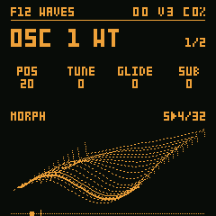

# ObsSynth FM-1

[Português](README.pt-BR.md) · **[Play it in the browser](https://orianbsilva.github.io/obssynth-fm1/)** ·
[Manual](https://orianbsilva.github.io/obssynth-fm1/#manual)



A synthesizer firmware for the **M-VAVE FM-1**, with a web simulator that runs the same C code compiled to
WebAssembly. Its base comes from [Hortator](https://github.com/deadactive/hortator) (DEADACTIVE), a fork of
[Felucca](https://github.com/hugelton/Felucca) (Leo Kuroshita, Hügelton Instruments): the HAL, the boot, the key and
knob scan, the LCD, the I2S audio out, the update loader and the simulator. The drum machine is gone; the voice and
the screen are new, after the ObsSynth desktop instruments.

> **Status: not tested on an FM-1 yet.** The firmware builds for the device (`./build.sh` passes every image check)
> and runs in the simulator, but it has never booted on real hardware. Do not install it until a release says it
> was tested; the [way back](#leaving-this-firmware) is described below.

## What it does

- **Oscillator engines** (ALGORITHM, per oscillator): STD (SAW, SQR, TRI, SIN, RAMP, FOLD, FM, OCT; PW becomes
  SHAPE on each), SUPER (7 saws, DETUN and SIDE, at the energy of one), WT (4 wavetable banks, POS and TABLE, 10
  levels per octave, no aliasing; the LFOs can move POS) and GRAIN (granular over 3 samples: ORGAN and BELL from
  VCSL, CC0, and a generated VOX; up to 6 Hann-windowed grains per oscillator and voice, POS, SMPL, SIZE, DENS and
  SPRAY).
- **Voice:** 2 oscillators (OSC 2 with SEMI, FINE and MIX), SUB, NOISE in six colours, SYNC and RING → a 12 or 24 dB
  filter (LP, BP, HP, NOTCH; Simper's trapezoidal SVF, with DRIVE) → amp. Amp and filter ADSRs with velocity, key
  tracking and LOOP; the filter envelope's amount, key tracking and GLIDE.
- **Modes:** POLY (4 voices), MONO, LEGATO and UNI (the 4 voices on one note, detuned and spread in stereo). Voice
  stealing: a free voice, else the oldest released, else the oldest.
- **2 LFOs** (SIN TRI SAW SQR S&H, 0.05–40 Hz), each with one destination (PITCH, CUT, RESO, AMP, MIX, POS, or one
  oscillator's pitch, shape, position or detune, or NOISE) and DEPTH ±; TRIG, FADE and PHASE.
- **Effects:** DELAY (TIME 10 ms–1.47 s, FDBK, COLR, MIX) and a ROOM reverb (SIZE, DAMP, DLY, MIX), Hortator's; a
  stereo CHORUS (RATE, DEPTH, WIDTH, MIX). Stereo out with a soft clip.
- **Presets:** 14 factory sounds and 16 of your own on the flash (Felucca's `storage.c`: A/B records, so a power cut
  keeps the previous bank).
- **Screen:** each page draws what it edits: the envelope curves, the LFO wave, the filter response, the wavetable,
  the live grains; in the ObsSynth palettes (GLOBAL 2).
- **GLOBAL:** MIDI channel, master tuning (±50 cents), velocity curve and button lights, kept apart from the presets.
- **USB:** a class-compliant USB-MIDI device named **ObsSynthFM1** (notes on any channel, or on GLOBAL's CH only;
  CC 120/123 release everything) with the M-UPGRADE update entry. It is **not** a USB keyboard or mouse, and it never
  turns on the FM-1's Bluetooth / Wi-Fi radio.

The [manual](https://orianbsilva.github.io/obssynth-fm1/#manual) walks through every control and page.

## Install

The release package is `obssynth-fm1-VERSION.fwsc`, identity **FM-1_917**, built and signed by GitHub from the
tagged source with [fm1-build](https://github.com/zvenson/fm1-build) (see [Verify a package](#verify-a-package)).
Once a release has been tested on an FM-1 it will be offered on [The Firmware Hub](https://thefirmwarehub.com),
which installs it from the browser.

- **From the stock firmware (V15)** or **from another custom firmware** (Felucca, Hortator and the others built on
  Felucca's update entry): the installer talks to the running firmware's update entry, which stages the package's
  own update loader (Felucca's); the loader then writes the firmware. Connect the FM-1 straight into the computer
  with a USB data cable, charged.
- **An interrupted update** (a cable pulled, the battery empty): the update loader keeps a record on the flash and
  starts again at the next power-on, so run the installer again and it resumes. If the FM-1 does not start at all,
  hold OCT− and OCT+ for 5 s for the chip's boot mode (UBOOT), which cannot be erased.
- From a terminal: `tools/fm1_install.py obssynth-fm1-VERSION.fwsc` (needs `mido` and `python-rtmidi`).

## Leaving this firmware

- **To another custom firmware:** install it as you installed this one; ObsSynth answers the same M-UPGRADE update
  entry.
- **Back to the stock firmware:** M-VAVE's updater, M-UPGRADE, at
  [m-vave.com/download](https://www.m-vave.com/download) (Downloads → PC Software → M-UPGRADE, with PC Firmware →
  FM-1 V15).
- **If the FM-1 does not start:** hold OCT− + OCT+ for 5 s, or let the firmware crash twice in its first 30 s (the
  boot-loop guard), then follow [docs/RECOVERY.md](docs/RECOVERY.md).

**Compatibility:** ObsSynth keeps its own presets and settings on the flash. It does not read the projects,
patterns or samples of other firmwares, and they may be overwritten: back them up before installing. Both FM-1
flash chips are supported (the Puya P25Q80 and the UC25HQ80 of units sold since autumn 2026).

## Verify a package

```
gh attestation verify obssynth-fm1-0.1.0.fwsc --repo orianbsilva/obssynth-fm1 \
    --signer-workflow zvenson/fm1-build/.github/workflows/build.yml
```

## Build

| What | How |
| --- | --- |
| The device firmware | `./build.sh` (the JieLi toolchain and AC79 SDK: [BUILDING.md](BUILDING.md)); `./build.sh --release 0.1.0` writes the release package |
| The simulator | `tools/build_sim.sh`, then `python3 -m http.server -d build/sim 8000` ([docs/SIMULATOR.md](docs/SIMULATOR.md)); needs `cc` and `zig` (or `ZIG="python3 -m ziglang"`) |
| The tests | `tests/run_tests.sh` (no hardware, no toolchain) |

A release is a `v*` tag: [.github/workflows/release.yml](.github/workflows/release.yml) hands it to fm1-build, which
builds, tests, attests and attaches the package. The simulator page goes to GitHub Pages from `main`
([.github/workflows/pages.yml](.github/workflows/pages.yml)).

## Layout

| Where | What |
| --- | --- |
| `firmware/hal/` | the FM-1 HAL (registers only here), Felucca's |
| `firmware/loader/` | the update loader, pinned by hash (`tools/frozen_base.txt`) |
| `firmware/src/synth.c` | the firmware's single unit (the include order matters) |
| `firmware/src/dsp.c` `voice.c` `engine.c` `fx.c` | fixed-point DSP, the voice, the engine (parameters, voices, LFOs, note queue), the effects |
| `firmware/src/audio.c` `panel.c` `ui.c` `main.c` | the audio ISR, the panel map, the screen and input, boot and loop |
| `firmware/src/storage.c` `presets.c` | flash records (Felucca's), the factory presets and the user bank |
| `firmware/src/usb.c` `ota.c` `midi.c` | USB-MIDI and the update entry (the loader's own: do not change), MIDI in |
| `assets/` | the wavetable banks, the GRAIN samples, the pixel fonts |
| `tests/` | the simulator core (the same firmware with the HAL as state) and the host tests |
| `web/sim/` | the simulator page, in English (`index.html`) and Portuguese (`pt.html`) |
| `tools/` | the device and simulator builds, tables, font, package, installer, recovery |

## Licence

GPL-3.0-only, like Felucca and Hortator: see [LICENSE](LICENSE) and [LICENSING.md](LICENSING.md). "M-VAVE" and
"FM-1" are trademarks of their owners; ObsSynth FM-1 is independent firmware, not affiliated with M-VAVE.
