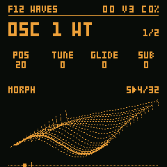

# ObsSynth FM-1

[English](README.md) · **[Toque no navegador](https://orianbsilva.github.io/obssynth-fm1/pt.html)** ·
[Manual](https://orianbsilva.github.io/obssynth-fm1/pt.html#manual)



Firmware de sintetizador para o **M-VAVE FM-1**, com um simulador web que roda o mesmo código C compilado para
WebAssembly. A base veio do [Hortator](https://github.com/deadactive/hortator) (DEADACTIVE), um fork do
[Felucca](https://github.com/hugelton/Felucca) (Leo Kuroshita, Hügelton Instruments): HAL, boot, scan de teclas e
knobs, LCD, saída de áudio I2S, loader de atualização e o simulador. A bateria saiu; a voz e a tela são novas, a
partir dos instrumentos ObsSynth do desktop.

> **Estado: 0.1.0, testado num FM-1:** instalado a partir do firmware original (V15) e de outro firmware
> customizado, e removido de novo. Instalação por sua conta e risco, sem garantia; o
> [caminho de volta](#saindo-deste-firmware) está abaixo.

## O que faz

- **Motores de oscilador** (ALGORITHM, por oscilador): STD (SAW, SQR, TRI, SIN, RAMP, FOLD, FM, OCT; o PW vira SHAPE
  em cada uma), SUPER (7 serras, DETUN e SIDE, com a energia de uma), WT (4 bancos de wavetable, POS e TABLE, 10
  níveis por oitava, sem aliasing; os LFOs podem mover o POS) e GRAIN (granular sobre 3 amostras: ORGAN e BELL do
  VCSL, CC0, e uma VOX gerada; até 6 grãos com janela Hann por oscilador e voz, POS, SMPL, SIZE, DENS e SPRAY).
- **Voz:** 2 osciladores (o OSC 2 com SEMI, FINE e MIX), SUB, NOISE em seis cores, SYNC e RING → filtro de 12 ou 24 dB
  (LP, BP, HP, NOTCH; SVF trapezoidal de Simper, com DRIVE) → amp. ADSRs de amplitude e de filtro com velocity, key
  tracking e LOOP; a quantidade do envelope do filtro, key tracking e GLIDE.
- **Modos:** POLY (4 vozes), MONO, LEGATO e UNI (as 4 vozes numa nota, desafinadas e espalhadas no estéreo). Roubo de
  voz: uma livre, senão a mais antiga já solta, senão a mais antiga.
- **2 LFOs** (SIN TRI SAW SQR S&H, 0,05–40 Hz), cada um com um destino (PITCH, CUT, RESO, AMP, MIX, POS, ou a altura,
  a forma, a posição ou o detune de um oscilador só, ou NOISE) e DEPTH ±; TRIG, FADE e PHASE.
- **Efeitos:** DELAY (TIME 10 ms–1,47 s, FDBK, COLR, MIX) e um reverb ROOM (SIZE, DAMP, DLY, MIX), os do Hortator; um
  CHORUS estéreo (RATE, DEPTH, WIDTH, MIX). Saída estéreo com saturação suave.
- **Presets:** 14 sons de fábrica e 16 seus na flash (o `storage.c` do Felucca: registros A/B, um corte de energia
  mantém o banco anterior).
- **Tela:** cada página desenha o que edita: as curvas dos envelopes, a onda do LFO, a resposta do filtro, a
  wavetable, os grãos ao vivo; nas paletas do ObsSynth (GLOBAL 2).
- **GLOBAL:** canal MIDI, afinação geral (±50 cents), curva de velocity e luz dos botões, guardados fora dos presets.
- **USB:** um dispositivo USB-MIDI class compliant chamado **ObsSynthFM1** (notas em qualquer canal, ou só no CH do
  GLOBAL; CC 120/123 soltam tudo), com a entrada de atualização do M-UPGRADE. **Não** é teclado nem mouse USB, e
  nunca liga o rádio Bluetooth / Wi-Fi do FM-1.

O [manual](https://orianbsilva.github.io/obssynth-fm1/pt.html#manual) passa por cada controle e cada página.

## Instalar

O pacote da release é `obssynth-fm1-VERSÃO.fwsc`, identidade **FM-1_917**, gerado e assinado pelo GitHub a partir do
código da tag, com o [fm1-build](https://github.com/zvenson/fm1-build) (ver [Conferir um pacote](#conferir-um-pacote)).
Ele está (ou logo estará) no [The Firmware Hub](https://thefirmwarehub.com), que instala pelo navegador.

- **Do firmware original (V15)** ou **de outro firmware customizado** (Felucca, Hortator e os outros feitos sobre a
  entrada de atualização do Felucca): o instalador fala com a entrada de atualização do firmware que está rodando,
  que prepara o loader de atualização do próprio pacote (o do Felucca); o loader então grava o firmware. Ligue o FM-1
  direto no computador, com um cabo USB de dados, carregado.
- **Uma atualização interrompida** (cabo solto, bateria acabou): o loader de atualização guarda um registro na
  flash e recomeça no próximo liga, então rode o instalador de novo e ele continua. Se o FM-1 não ligar de jeito
  nenhum, segure OCT− e OCT+ por 5 s para o modo de boot do chip (UBOOT), que não pode ser apagado.
- Pelo terminal: `tools/fm1_install.py obssynth-fm1-VERSÃO.fwsc` (precisa de `mido` e `python-rtmidi`).

## Saindo deste firmware

- **Para outro firmware customizado:** instale como instalou este; o ObsSynth responde à mesma entrada de
  atualização do M-UPGRADE.
- **De volta ao firmware original:** o atualizador da M-VAVE, M-UPGRADE, em
  [m-vave.com/download](https://www.m-vave.com/download) (Downloads → PC Software → M-UPGRADE, com PC Firmware →
  FM-1 V15).
- **Se o FM-1 não ligar:** segure OCT− + OCT+ por 5 s, ou deixe o firmware travar duas vezes nos primeiros 30 s (a
  proteção contra boot em loop), e siga o [docs/RECOVERY.md](docs/RECOVERY.md).

**Compatibilidade:** o ObsSynth guarda os próprios presets e configurações na flash. Ele não lê projetos, padrões
ou amostras de outros firmwares, e eles podem ser sobrescritos: faça backup antes de instalar. Os dois chips de flash
do FM-1 funcionam (o Puya P25Q80 e o UC25HQ80 das unidades vendidas desde o outono de 2026).

## Conferir um pacote

```
gh attestation verify obssynth-fm1-0.1.0.fwsc --repo orianbsilva/obssynth-fm1 \
    --signer-workflow zvenson/fm1-build/.github/workflows/build.yml
```

## Build

| O quê | Como |
| --- | --- |
| O firmware do aparelho | `./build.sh` (o toolchain da JieLi e o SDK AC79: [BUILDING.md](BUILDING.md)); `./build.sh --release 0.1.0` gera o pacote da release |
| O simulador | `tools/build_sim.sh`, depois `python3 -m http.server -d build/sim 8000` ([docs/SIMULATOR.md](docs/SIMULATOR.md)); precisa de `cc` e `zig` (ou `ZIG="python3 -m ziglang"`) |
| Os testes | `tests/run_tests.sh` (sem aparelho, sem toolchain) |

Uma release é uma tag `v*`: o [.github/workflows/release.yml](.github/workflows/release.yml) passa para o
fm1-build, que compila, testa, atesta e anexa o pacote. A página do simulador vai para o GitHub Pages a partir da
`main` ([.github/workflows/pages.yml](.github/workflows/pages.yml)).

## Estrutura

| Onde | O quê |
| --- | --- |
| `firmware/hal/` | o HAL do FM-1 (registradores só aqui), o do Felucca |
| `firmware/loader/` | o loader de atualização, fixado por hash (`tools/frozen_base.txt`) |
| `firmware/src/synth.c` | a unidade única do firmware (a ordem dos includes importa) |
| `firmware/src/dsp.c` `voice.c` `engine.c` `fx.c` | DSP em ponto fixo, a voz, o motor (parâmetros, vozes, LFOs, fila de notas), os efeitos |
| `firmware/src/audio.c` `panel.c` `ui.c` `main.c` | a ISR de áudio, o mapa do painel, tela e entrada, boot e loop |
| `firmware/src/storage.c` `presets.c` | registros na flash (do Felucca), os presets de fábrica e o banco do usuário |
| `firmware/src/usb.c` `ota.c` `midi.c` | USB-MIDI e a entrada de atualização (as do loader: não mudar), a entrada MIDI |
| `assets/` | os bancos de wavetable, as amostras do GRAIN, as fontes de pixel |
| `tests/` | o núcleo do simulador (o mesmo firmware com o HAL trocado por estado) e os testes de host |
| `web/sim/` | a página do simulador, em inglês (`index.html`) e português (`pt.html`) |
| `tools/` | builds do aparelho e do simulador, tabelas, fonte, pacote, instalador, recuperação |

## Licença

GPL-3.0-only, como o Felucca e o Hortator: ver [LICENSE](LICENSE) e [LICENSING.md](LICENSING.md). "M-VAVE" e "FM-1"
são marcas de seus donos; o ObsSynth FM-1 é um firmware independente, sem relação com a M-VAVE.
